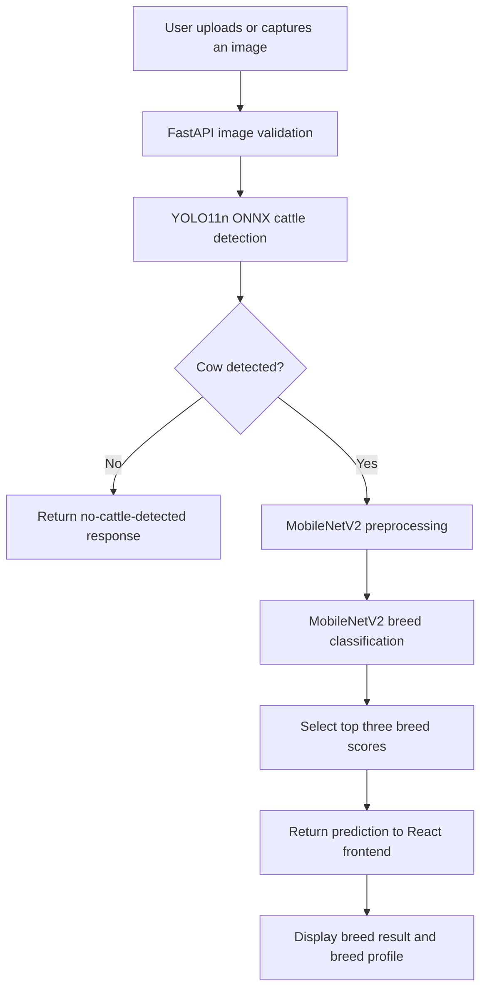

# CattleVision – Cattle Breed Identification System

CattleVision is an AI-powered web application that checks whether an uploaded image contains cattle and, when cattle are detected, predicts the animal's breed from 18 supported cattle breeds.

The application combines a YOLO11n object-detection model with a MobileNetV2 image-classification model. A React frontend provides image upload, camera capture, breed exploration and prediction results, while a FastAPI backend runs the AI inference pipeline.

> **Scope:** The classifier is a closed-set model. It returns one of the 18 breeds it was trained on; it is not designed to identify every cattle breed. The YOLO stage checks for the COCO `cow` class, but object detection is not perfect and can produce missed detections or false detections.

## Features

- **Cattle presence verification:** YOLO11n checks the uploaded image for a cow before breed classification.
- **18-breed classification:** MobileNetV2 predicts one of the supported cattle breeds.
- **Top-three predictions:** The interface displays the three highest-scoring breed predictions.
- **Image upload:** Supports JPG/JPEG, PNG and WEBP images, with a 10 MB upload limit.
- **Live camera capture:** Users can capture an image through a device camera where browser permissions and HTTPS/localhost requirements allow it.
- **Breed library:** Displays breed cards, a detail view for each breed and a six-at-a-time “View More” interaction.
- **Breed information:** Shows available native-region, category, physical-characteristic and traditional-use information.
- **Responsive interface:** React UI with layouts for desktop, tablet and mobile screens.
- **Input validation and error handling:** Rejects unsupported file types, empty uploads, oversized images and images where the detector does not find cattle.

## AI Workflow



### Model responsibilities

| Model/component | Responsibility |
|---|---|
| YOLO11n (ONNX) | Detects objects using the COCO `cow` class. It verifies cattle presence; it does not identify the cattle breed. |
| MobileNetV2 (Keras) | Classifies an image into one of the 18 supported breed classes after the cattle-detection stage passes. |
| ONNX Runtime | Runs the YOLO11n ONNX model. |
| OpenCV | Decodes and preprocesses images for object detection. |
| TensorFlow/Keras | Loads and runs the MobileNetV2 classification model. |

The detection score and breed-classification score are separate model outputs. They should not be interpreted as calibrated probabilities or guarantees of correctness.

## Supported Cattle Breeds

The MobileNetV2 classifier uses the following 18 class labels:

1. Bargur
2. Dangi
3. Gir
4. Hallikar
5. Himachali Pahari
6. Kangayam
7. Mewati
8. Nari
9. Ongole
10. Poda Thirupu
11. Pulikulam
12. Purnea
13. Red kandhari
14. Tharparkar
15. Umblachery
16. motu
17. ponwar
18. siri

The class-label spelling and capitalization must match the entries in `models/final/class_names_18breed.json`.

## Dataset

The 18-breed image dataset used for model development contains **3,665 images**.

| Dataset split | Number of images |
|---|---:|
| Training | 2,558 |
| Validation | 549 |
| Testing | 558 |
| **Total** | **3,665** |

The dataset is organized into training, validation and testing splits. Include the dataset source, collection method and any usage permissions in this section before public release if those details are available.

## Technology Stack

### Frontend

- React
- Vite
- Tailwind CSS v4
- Lucide React
- JavaScript

### Backend and AI

- Python 3.14.3 (development environment)
- FastAPI
- Uvicorn
- TensorFlow / Keras (MobileNetV2 classifier)
- ONNX Runtime 1.31.1 (YOLO11n inference)
- OpenCV 5.0.0 (image processing)
- NumPy

## Project Structure

The main project files are organized approximately as follows:

```text
Cattle Vision/
├── backend/
│   ├── main.py
│   └── cattle_detector.py
│
├── frontend/
│   ├── src/
│   │   ├── assets/
│   │   ├── data/
│   │   │   └── breedDetails.js
│   │   ├── App.jsx
│   │   └── index.css
│   ├── package.json
│   └── vite.config.js
│
├── models/
│   ├── detection/
│   │   └── yolo11n.onnx
│   └── final/
│       ├── mobilenetv2_18breed_finetuned_best.keras
│       └── class_names_18breed.json
│
├── test_cattle_detector.py
└── README.md
```

Other project folders and files may exist locally, such as the dataset, training scripts, evaluation outputs and virtual environment. Do not commit virtual-environment folders such as `.venv/` to source control.

## Setup and Run

### Prerequisites

- Windows 10/11 or another supported operating system.
- Python environment containing the backend dependencies.
- Node.js and npm.
- The trained MobileNetV2 model, class-name JSON file and YOLO11n ONNX model at the paths shown in the project structure.

The development environment used for this project included Python 3.14.3, ONNX Runtime 1.31.1 and OpenCV 5.0.0. TensorFlow was used to load the existing Keras model. Use compatible dependency versions when recreating the environment; do not replace the working project environment without testing model loading first.

### 1. Clone the repository

```powershell
git clone <YOUR_REPOSITORY_URL>
cd "Cattle Vision"
```

Replace `<YOUR_REPOSITORY_URL>` with the repository URL. If the repository directory has a different name, change the `cd` command accordingly.

### 2. Configure the backend environment

Activate the project virtual environment if one is already present:

```powershell
.\.venv\Scripts\Activate.ps1
```

If setting up a new environment, create and activate it using a Python version compatible with the TensorFlow build and all backend dependencies used by the project. Then install the project's backend dependencies. A `requirements.txt` should be maintained with the exact tested package versions before sharing the repository.

At minimum, the backend uses FastAPI, Uvicorn, `python-multipart`, NumPy, TensorFlow, ONNX Runtime and OpenCV Headless.

### 3. Check model files

Make sure these files exist:

```text
models/detection/yolo11n.onnx
models/final/mobilenetv2_18breed_finetuned_best.keras
models/final/class_names_18breed.json
```

The backend will not start prediction successfully if a required model file is missing or its configured path does not match the actual file location.

### 4. Start the FastAPI backend

From the project root, with the backend virtual environment activated:

```powershell
python -m uvicorn backend.main:app --reload --host 127.0.0.1 --port 8000
```

The API will be available at:

- API base: `http://127.0.0.1:8000`
- Interactive API documentation: `http://127.0.0.1:8000/docs`

If the backend is normally started from inside the `backend` directory in your local setup, use the corresponding Uvicorn module command configured for that working directory.

### 5. Start the React frontend

Open a second terminal:

```powershell
cd frontend
npm install
npm run dev
```

Open the local URL printed by Vite, usually `http://localhost:5173`.

The frontend's current prediction request uses `http://127.0.0.1:8000/predict`. If the backend host or port changes, update the frontend API URL or configure it through an environment variable.

## API Reference

### `POST /predict`

Accepts an image as `multipart/form-data` using the form field name `file`.

**Accepted image types:** JPEG, PNG and WEBP.  
**Maximum upload size:** 10 MB.

#### Successful response

```json
{
  "success": true,
  "predicted_breed": "siri",
  "confidence": 99.92,
  "top_predictions": [
    {
      "breed": "siri",
      "confidence": 99.92
    },
    {
      "breed": "ponwar",
      "confidence": 0.07
    },
    {
      "breed": "Bargur",
      "confidence": 0.01
    }
  ],
  "cattle_detected": true,
  "detection_confidence": 60.13
}
```

The values above are an example response from a development test, not a benchmark or guaranteed result.

#### Image rejected because no cattle were detected

The API returns HTTP `422` with a response similar to:

```json
{
  "detail": "No cattle detected. Please upload a clear image containing cattle."
}
```

Other validation responses may include:

- `400` — unsupported image content type or empty upload.
- `413` — image exceeds the 10 MB upload limit.
- `422` — no cattle detected by the YOLO detection stage.
- `500` — unexpected prediction failure.

## Test the Cattle Detector

A small interactive test script is provided at the project root:

```powershell
python test_cattle_detector.py
```

When prompted, enter or drag-and-drop the full path to an image file, then press Enter. The script reports whether the YOLO detector found a cow and prints its detection score and bounding box when present.

Test with multiple examples, including cattle images from different breeds and poses, as well as unrelated images. A successful result on a small set of images does not establish perfect detection performance.

## Important Limitations

- The classifier predicts only among its 18 trained breed classes. It does not have an explicit “unknown breed” classification class.
- The YOLO model uses the COCO `cow` object class as a cattle-presence check. It may miss distant, obscured or unusual cattle images and may occasionally detect a non-cattle object incorrectly.
- A successful cattle detection does not prove that the image contains one of the 18 supported breeds.
- Breed and detection scores are model scores, not calibrated probabilities or guarantees of correctness.
- Prediction quality can vary with image resolution, lighting, background, camera angle, occlusion and similarity between breeds.
- The detector and classifier should be evaluated on a broader, separate test set before use in a production environment.

## Future Work

Potential future improvements include:

- More extensive testing across lighting conditions, poses and backgrounds.
- Evaluation of false-positive and false-negative cattle detections.
- A documented, reproducible model-evaluation report for the 18-breed classifier.
- Configurable API URLs and deployment settings.
- Automated tests for API validation and prediction responses.

## License and Model Attribution

Add the project's chosen software license and dataset attribution before publishing the repository. Also review and comply with the license and usage conditions attached to the pretrained YOLO11n model and any other third-party model or dataset assets included with the project.

## Acknowledgements

- TensorFlow and Keras for the image-classification framework.
- Ultralytics YOLO model family for the object-detection model.
- ONNX Runtime for ONNX inference.
- FastAPI for the backend API framework.
- React, Vite and Tailwind CSS for the frontend application.
